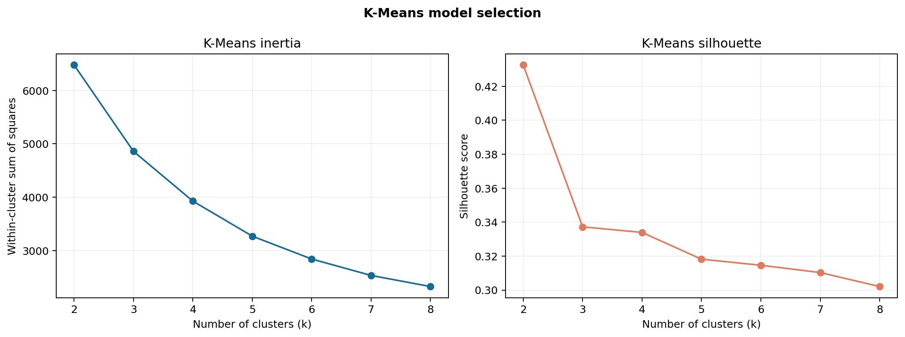
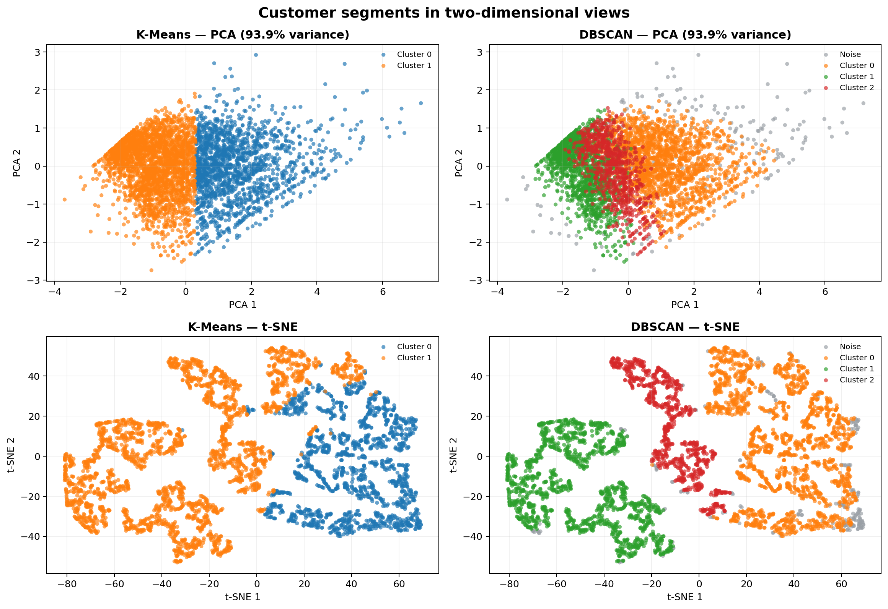
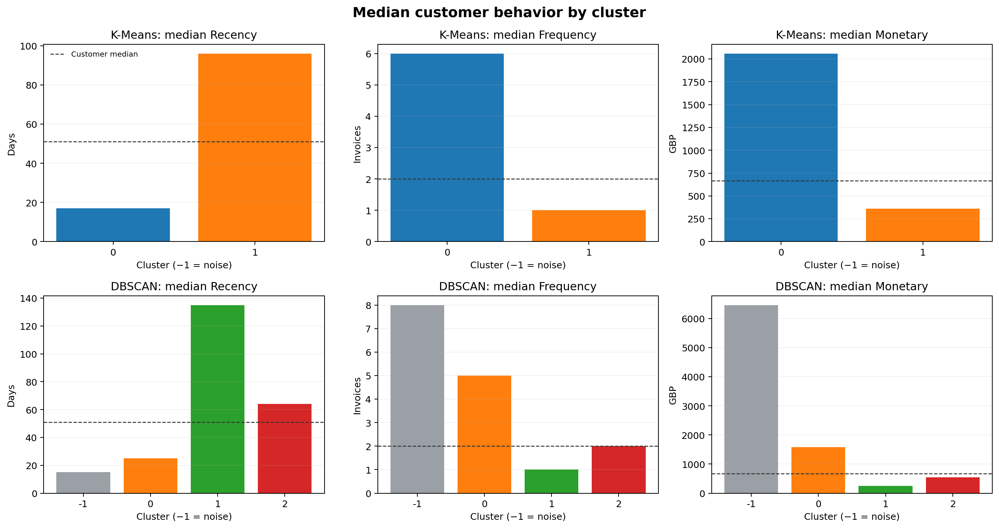

# E-Commerce Customer Segmentation: Case Study

## Business question

How can an online retailer use observed customer purchase behavior to prioritize retention, loyalty, and reactivation campaigns?

## Executive summary

The cleaned UCI Online Retail extract contains **392,692 purchase lines** from **4,338 customers**, with an RFM snapshot date of **2011-12-10**. K-Means selected **2 segments** from the tested range using the highest silhouette score (**0.433**). DBSCAN found **3 dense segment(s)** at ε=0.35 and marked **4.6%** of customers as noise. The first two PCA components explain **93.9%** of standardized log-RFM variance.

## Data preparation

Source: [UCI Online Retail](https://archive.ics.uci.edu/dataset/352/online%2Bretail), covering transactions from December 2010 through December 2011. Recency is measured in days before the snapshot; frequency counts distinct purchase invoices; monetary value is observed spend in GBP.

| Cleaning step | Rows |
|---|---:|
| Source records | 541,909 |
| Missing customer ID removed | 135,080 |
| Cancellation invoices removed | 8,905 |
| Invalid or non-positive records removed | 40 |
| Exact duplicate rows removed | 5,192 |
| Purchase lines retained | 392,692 |

Features were log1p-transformed and standardized before clustering. The default snapshot is one day after the final valid purchase date in the input.

## K-Means personas

The selected K-Means model used k=2. Cluster IDs are arbitrary and should be interpreted through their RFM profiles.

| Cluster | Customers | Share | Median recency | Median invoices | Median spend | Persona |
|---:|---:|---:|---:|---:|---:|---|
| 0 | 1,668 | 38.5% | 17 days | 6.0 | £2,058.17 | Champions |
| 1 | 2,670 | 61.5% | 96 days | 1.0 | £362.01 | Needs reactivation |

Suggested campaign hypotheses:

- **Champions (cluster 0):** Reward advocacy with early access or a referral offer; protect margin with recognition before discounting.
- **Needs reactivation (cluster 1):** Run a low-cost reactivation test and suppress further spend if the customer stays inactive.

## DBSCAN personas

With ε=0.35 and min_samples=8, DBSCAN assigns dense points to clusters and leaves sparse observations as noise. Noise is not a customer persona and should not be targeted as one.

| Cluster | Customers | Share | Median recency | Median invoices | Median spend | Persona |
|---:|---:|---:|---:|---:|---:|---|
| -1 | 201 | 4.6% | 15 days | 8.0 | £6,463.84 | Unassigned (noise) |
| 0 | 1,858 | 42.8% | 25 days | 5.0 | £1,582.70 | Champions |
| 1 | 1,464 | 33.7% | 135 days | 1.0 | £256.01 | Needs reactivation |
| 2 | 815 | 18.8% | 64 days | 2.0 | £540.13 | Steady customers |

Suggested campaign hypotheses:

- **Unassigned (noise) (cluster -1):** Review individually or with a separate rule-based audience; avoid treating sparse behavior as a stable persona.
- **Champions (cluster 0):** Reward advocacy with early access or a referral offer; protect margin with recognition before discounting.
- **Needs reactivation (cluster 1):** Run a low-cost reactivation test and suppress further spend if the customer stays inactive.
- **Steady customers (cluster 2):** Maintain useful product updates and test a modest loyalty benefit against a no-offer holdout.

## DBSCAN parameter sensitivity

The epsilon sweep makes the density trade-off visible. Smaller neighborhoods produce more fragments and more noise; larger neighborhoods merge groups. Review the full table before applying DBSCAN settings to another retailer.

| ε | Clusters | Noise | Smallest cluster | Largest cluster share |
|---:|---:|---:|---:|---:|
| 0.25 | 13 | 12.5% | 5 | 32.5% |
| 0.30 | 4 | 8.0% | 460 | 33.3% |
| 0.35 | 3 | 4.6% | 815 | 42.8% |
| 0.40 | 3 | 3.2% | 825 | 44.0% |
| 0.45 | 2 | 2.1% | 1,476 | 63.8% |
| 0.50 | 2 | 1.6% | 1,483 | 64.2% |
| 0.55 | 2 | 1.3% | 1,484 | 64.5% |
| 0.60 | 1 | 1.2% | 4,288 | 98.8% |
| 0.65 | 1 | 1.0% | 4,296 | 99.0% |

The analysis uses ε=0.35. At this setting it finds 3 cluster(s), with 4.6% of customers marked as noise.

## Visualizations

PCA preserves linear variance, while t-SNE is intended to show local neighborhoods and can distort global distances. Use the profiles and business experiments to judge usefulness, not apparent separation in a 2D map.

## Recommended next steps

1. Refresh RFM with recent transactions and evaluate whether segment memberships are stable over time.
2. Run holdout-based tests for reactivation, loyalty, and cross-sell ideas; compare incremental margin and repeat purchase, not just opens or clicks.
3. Suppress customers who do not respond and review opt-in, privacy, and contact-frequency rules before activation.

## Limitations

This is one retailer's historical sample with a finite observation window. The personas summarize relative purchase behavior; they are not causal, permanent, or validated response propensities. K-Means assigns every customer. DBSCAN's noise points are excluded when calculating its silhouette score.

Dataset citation: Chen, D. (2015). *Online Retail* [Dataset]. UCI Machine Learning Repository. https://doi.org/10.24432/C5BW33. Licensed under [CC BY 4.0](https://creativecommons.org/licenses/by/4.0/).
